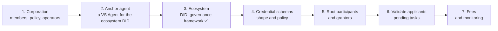

# The ecosystem builder's path

An ecosystem is a governance decision before it is a registry entry. This page gives the order of operations and the homework; the guides that follow do each step in the frontend.

## Before the frontend

- **Write the governance framework.** Mission, the credentials you govern, who may join in which role and on what evidence, fees, obligations, what gets a participant revoked or slashed, how disputes are handled. The Verana Council publishes templates; the ECS ecosystem's framework is a worked example. Publish it at a stable URL; you will register its digest.
- **Design the schemas.** For each credential: the claims as a JSON schema, the onboarding mode per role, validity periods, the pricing asset. Changing a schema later means a new schema, so decide carefully; changing validity periods is allowed.
- **Decide the tree.** Will you validate every issuer yourself, or accredit grantors who do it in their region or sector? Will holders have entries (so issuers can revoke) or stay permissionless?
- **Decide the money.** Free, or validation fees, or pay per issuance and verification. Priced in the native coin for now in the frontend.

## In the frontend, in order

0. New to the frontend? [Get started](./05-get-started.md): connect a wallet, get testnet VNA, find your way around.
1. [Create a corporation](./10-create-corporation.md), then [operators and proposals](./11-operators-proposals.md).
2. Deploy the [ecosystem anchor](./21-ecosystem-anchor.md): a VS Agent whose DID will be the ecosystem's DID. Make it a trusted Verifiable Service like any other.
3. [Create the ecosystem](./20-create-ecosystem.md) with that DID and your governance framework.
4. [Define credential schemas](./30-credential-schemas.md). The anchor publishes their schema credentials automatically.
5. [Create root participants and grantors](./31-root-participants-grantors.md).
6. Announce, and [validate applicants](./40-validate-applicants.md) as they come. Applicants use [Discover & Join](./35-join-an-ecosystem.md).
7. [Design the fee model](./50-fee-model.md) and watch the tree.

## Where to look while you build

The frontend's **Ecosystems** page lists what your corporation controls; each ecosystem page shows its schemas and participant trees; **Pending Tasks** shows what waits for you. The [trust graph](https://search.testnet.verana.network) shows your ecosystem as the public sees it.
