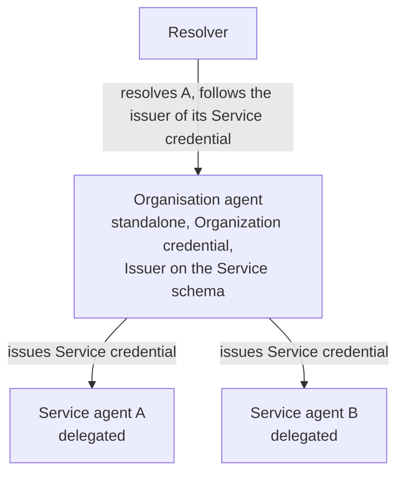

# Organisation with child services

When an organisation runs more than one service, or wants each service to have its own keys and DID, it runs one agent as the organisation and one agent per service. The organisation agent holds the Organization credential and an issuer accreditation on the ECS Service schema; it issues a Service credential to each child. A child runs in delegated mode and never touches the Organization credential.



## Goal

Child agents that resolve as trusted through their parent, each with its own DID.

## Prerequisites

- The organisation agent trusted, as in the [quickstart](./00-quickstart.mdx), with an active Issuer accreditation on the Service schema.
- A public origin per child.

## Steps

### 1. Deploy a child in delegated mode

Same deployment as any agent, with `AGENT_MODE=delegated`, `AGENT_DELEGATED_PARENT_VS_DID` set to the organisation's DID, and no claims: the parent decides the child's Service claims. The same corporation id, and an account of its own.

### 2. Start the child's onboarding process

In the frontend, open the participant tree of the ECS ecosystem's **Service** schema. Under **Issuers**, find your own organisation agent, accredited as issuer, and **join** the **Holders** folder under it: your organisation agent becomes the validator. Accept the governance framework, enter the child's DID, sign. See [Join an ecosystem](../ecosystems/35-join-an-ecosystem.md).

The join form does not set a VS operator. To name the child's account as VS operator, start the onboarding process from the command line instead: see [Let the agent pay with corporation funds](./81-pay-with-corporation-funds.mdx#how-it-is-declared).

### 3. Validate on the parent

The parent agent receives the onboarding request. Review it in the frontend's **Pending tasks** or through the parent's flow routes, set the claims of the child's Service credential (name, type, description, logo, terms, privacy), validate. The parent issues the credential over the connection; the child publishes it.

```bash
# on the parent
curl -s http://parent:3000/v2/vt/flows | jq '.items[] | select(.role=="validator")'
curl -s -X PUT http://parent:3000/v2/vt/flows/<participantSessionId>/claims -H 'content-type: application/json' \
  -d '{"claims":{"name":"Service A","type":"WEB_PORTAL","description":"…","logoUri":"https://…","minimumAgeRequired":0,"termsAndConditionsUri":"https://…","privacyPolicyUri":"https://…"}}'
curl -s -X POST http://parent:3000/v2/vt/flows/<participantSessionId>/validate -H 'content-type: application/json' -d '{}'
```

## Verify

Resolve the child's DID: trusted, with a Service credential whose issuer is the parent, and the parent's Organization credential surfaced as the controller. The frontend's Agents page shows both.

## Notes

- A child has no Organization credential and must not try to obtain one; the parent is the accountable party.
- Revoking the child's Holder accreditation on the parent revokes the child's Service credential; the child removes it automatically.
- Several children may share one parent; one child has exactly one parent.

## Next

- Specification: Verifiable Trust v4, `VS-REQ-4`; VS Agent v4, `VSA-VTI-ECS-DELEGATED`.
