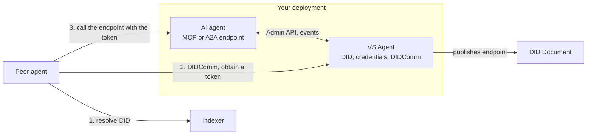

# Build an AI agent as a Verifiable Service

An AI agent is a service with a model inside. Make it verifiable the same way: a VS Agent next to it holds the DID and the credentials, and the AI agent exposes its own protocol endpoint behind trust resolution.

## Steps

1. **Deploy a VS Agent** for the AI agent and make it trusted, as a standalone organisation or as a child of your organisation agent ([child services](./22-child-services.mdx)). Its ECS Service credential describes the AI agent: name, type (for example `AI_AGENT`), description, operator.
2. **Declare the endpoint.** Add an `MCP` or `A2A` service entry pointing at your agent's endpoint ([endpoints](./32-endpoints.mdx)).
3. **Gate the endpoint.** Your endpoint accepts a token your backend issues over DIDComm to peers whose DID the VS Agent resolved as trusted, or it accepts a presentation of a credential your ecosystem defines for agents. Either way, trust is established before the first tool call.
4. **Verify peers before you call them.** When your AI agent chooses a counterpart, resolve its DID through the indexer (or through the Verana MCP server's tools) and proceed only on trusted; find candidates in the trust graph by what they prove.
5. **Identify the humans.** Issue ECS Badges to the people who operate or supervise the agent, from your organisation agent (the Badge schema is open to issuers and permissionless for holders). A counterpart that needs a human in the loop asks for one.

## Example

The [mcpi-two-vs-agents](https://github.com/verana-labs/mcpi-two-vs-agents) repository runs two AI agents, each with a VS Agent, that verify each other before exchanging anything.

## Next

- [AI agents and MCP](../ai-agents-mcp/index.md): give your AI agent the network as tools.
- Understand: [Verifiable AI agents](../../understand/identity/verifiable-ai-agents.md).
