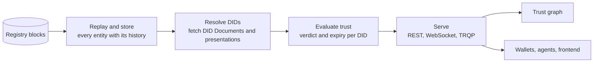

# Indexing the trust network

The registry stores facts; it does not interpret them. The indexer is the component that reads every block, follows every DID the registry mentions to its DID Document and its credentials, runs trust resolution on each, and serves the result. It is where the network becomes queryable.

## What it keeps

Every corporation, ecosystem, governance framework, schema, participant entry, deposit, delegation, digest and exchange rate, with the block at which each changed, so a question can be asked as of any height. Statistics per ecosystem, schema and participant: how many active participants, how many credentials issued and verified, how much deposit, how many slashes.

## What it computes

For every DID it meets it performs trust resolution and records the verdict, the time of evaluation and the exact moment the verdict expires. It re-evaluates when a transaction touches the DID or anything the verdict depended on, and when a service asks it to after changing its DID Document. The verdict is not a cache with a time to live; it is a derived fact with a known boundary.

## What it serves

- A REST API over every entity, with filtering, keyset pagination and point-in-time reads.
- A resolve endpoint that returns the verdict and the material of a Proof-of-Trust, section by section.
- A WebSocket stream of registry events, scoped to DIDs or to a corporation, with a catch-up pattern that leaves no gap.
- The ToIP Trust Registry Query Protocol, for relying parties that speak that standard.

## Why run your own

The public indexer is a convenience. A wallet vendor, a service operator or an auditor that wants to depend on nobody runs its own indexer against its own node: the data is public, the computation is deterministic, and two indexers agree. That is also what makes search results on Verana unmanipulable: they rest on verifiable data.

## Where next

- [The trust graph](./trust-graph.md): the query layer built on the indexer.
- Build: [Run the indexer](../../build/run-infrastructure/index.md).
- Reference: [Indexer API](../../reference/indexer-api/index.md).
- Specification: Indexer v4.
