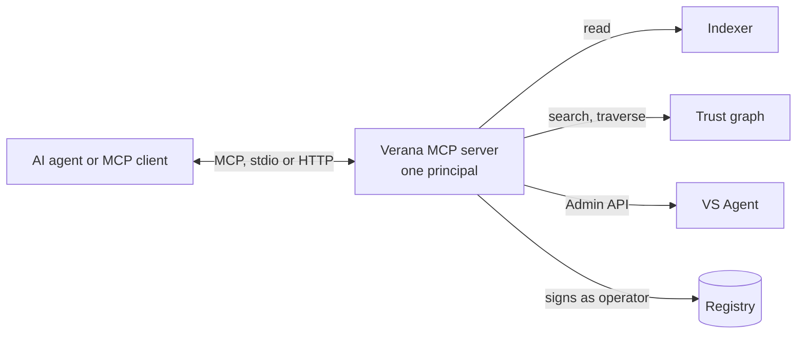

# MCP and AI discovery

The Model Context Protocol is how AI agents reach tools. The Verana MCP server gives an agent the network as tools: read the registry, search the trust graph, drive a VS Agent, and submit transactions on behalf of a corporation.

## One principal

A server instance acts for one corporation, with one operator key. Everything it signs is bounded by that operator's authorization: the message types the corporation listed, the spending limits, the expiry. The server adds no authority of its own; it makes the operator's authority usable from a conversation.

## Tool families

| Family | What the agent can do |
|---|---|
| Ledger | Submit any delegable registry message as the operator, and wait for the indexer to see it before answering, so the next read is consistent. |
| Indexer | Read corporations, ecosystems, schemas, participants, deposits, resolve a DID. |
| Graph | Search surfaces and run traversal queries. |
| VS Agent | Drive the agent's Admin API: connections, flows, offers, presentation requests. |
| Cosmos | Read-only chain queries: balances, accounts, blocks. |
| Wallet | The operator's own account and its state. |

Resources expose stable registry objects by URI; prompts package the common jobs.

## Discovery for agents

An agent that must choose a counterpart asks the graph: an issuer accredited for a given schema in a given ecosystem, a service operated by a verified company in a given jurisdiction, an agent holding a given certification. It then resolves the chosen DID before connecting, through the same tools. Discovery and verification use the same data, so an agent never acts on a claim it could not verify.

## Where next

- Build: [AI agents and MCP](../../build/ai-agents-mcp/index.md).
- Reference: [MCP server](../../reference/mcp-server.md).
- Specification: MCP server v4.
