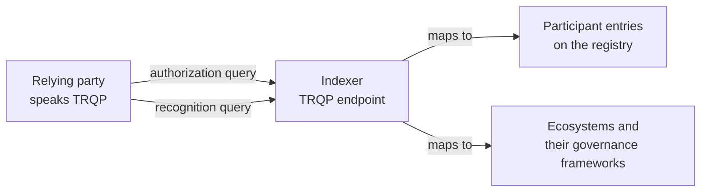

# TRQP

The Trust Registry Query Protocol is the Trust over IP standard for asking a trust registry two questions: is this entity authorized for this action under this governance framework, and does this registry recognise that other registry. Relying parties that speak TRQP can ask Verana without learning its data model.

## How Verana answers

An authorization query names an entity, an action and a resource, and asks whether the entity is authorized at a given time. The indexer maps the entity to a DID, the action to a role (issuer or verifier), the resource to a credential schema, and answers from the participant entries: an active accreditation at that time means yes. A recognition query asks whether one governance framework recognises another; the indexer answers from the ecosystems the registry holds and their active governance frameworks. A profile endpoint describes the registry and the vocabulary it uses.

## When to use TRQP rather than the graph

TRQP is for relying parties that already integrate trust registries through the standard and want Verana to be one more. The graph and the resolve endpoint are richer: they return the Proof-of-Trust material, the chains, the snippets. A wallet integrating Verana uses the resolve endpoint; a national infrastructure that federates registries through TRQP uses TRQP.

## Where next

- Reference: the TRQP routes in the [Indexer API](../../reference/indexer-api/index.md).
- Specification: [ToIP TRQP](https://trustoverip.github.io/tswg-trust-registry-protocol/); Indexer v4, TRQP section.
