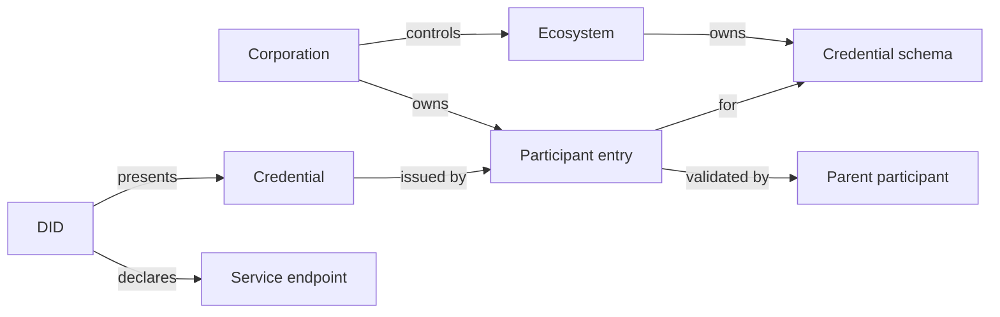

# The trust graph

Search on the ordinary web indexes content and ranks it by signals anyone can game. Search on Verana indexes trust: who is accredited by whom, for what, since when, and what every service proves about itself. The trust graph is that index.

## What is in it

Every DID the indexer trusts or has met, with its Essential Credentials and the other credentials it presents; every corporation, ecosystem, schema and participant entry by its stable registry identifier; every endpoint declared in a DID Document. Edges for ownership, control, accreditation, validation, issuance and presentation. Archived and revoked things stay reachable by traversal while something references them, but never come back as direct results.

## Two ways to ask

**Search** runs over one surface at a time: DIDs, ecosystems, corporations, schemas or endpoints. It is ranked and faceted: a free-text query plus filters such as the ecosystem, the schema, the country of the operator, the type of endpoint. It returns snippets, compact cards whose field groups the caller selects. By default it returns only trusted results.

**Traverse** runs one of a fixed set of canonical queries from a starting point: the trust summary of a DID, the participants of a DID by role, the validator chain of an accreditation, the issuers of a schema, the ecosystems a corporation controls. Each query has a defined input and output, so a client can rely on it.

## The questions it answers

Where is the customer support agent of this telecom company. Which shops in this city hold a verified business credential and sell a given product. Which ecosystems issue a given certification, and how many accredited issuers do they have. Who validated this issuer, and is that chain intact. Which services does this organisation operate.

## Who uses it

The search UI, for people. The Verana MCP server, for AI agents that need to find a counterpart by what it proves. Wallets, to enrich what they show. Ecosystems and auditors, to watch their tree.

## Where next

- [TRQP](./trqp.md): the standard query protocol next to the graph.
- Build: [Run the graph and search](../../build/run-infrastructure/index.md); [See your service in the graph](../../build/verifiable-services/index.md).
- Try it live: the discovery questions on the [playground home](https://playground.testnet.verana.network).
- Reference: [Graph API](../../reference/graph-api/index.md). Specification: Graph v4.
