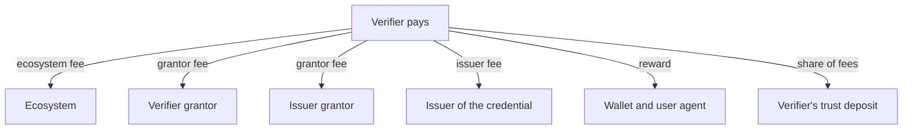

# The business model

An ecosystem can run on Verana without charging anything. When it does charge, the registry settles the fees, shares them along the participant tree, and grows every party's trust deposit as a side effect. Three kinds of fees exist, all set by the party that charges them on its own accreditation.

## Validation fees

A validator charges a fee for validating an applicant. The applicant pays it when it applies; the registry holds it in escrow and releases it on validation. The ecosystem charges grantors, grantors charge the issuers and verifiers they validate, issuers may charge the holders they onboard. A renewal pays again.

## Pay per issuance and pay per verification

An issuer may owe a fee each time it issues a credential of the schema, and a verifier each time it verifies one. The fee is the sum of what every party above the payer in the tree charges for that operation, plus the issuer's own verification fee when a verifier presents a credential it issued. The payer settles it by recording a session on the registry before the exchange. Wallets check that the session exists and refuse an exchange that is not paid for.

## Where the money goes

On every fee paid, a share set by the network (five percent at the time of writing) goes to the payer's trust deposit, and the same share of every amount received goes to the recipient's deposit; the rest is liquid for the recipient. When a wallet took part in the exchange, two further shares reward the wallet and the user agent it runs in: the business model pays the software that protects the user. Because the deposit grows with activity and cannot be withdrawn, long-standing participants accumulate a stake that signals their history.

## Pricing assets and exchange rates

Each schema prices its fees in one asset. The network's coin is the simplest. The trust unit is a stable unit of account converted to coin at transaction time through an exchange rate that network governance maintains and bounds; it protects an ecosystem from pricing a validation at a coin amount whose value swings. A fiat currency means the registry records who owes what and the payment happens off chain. Whatever the asset, the trust deposit is always taken in coin.

Exchange rates are owned by network governance, not by ecosystems: governance creates a rate and authorises an operator to refresh it within limits (a minimum interval, a maximum deviation), so the oracle stays responsive and bounded. An expired or disabled rate blocks the transactions that depend on it rather than charging an unknown amount.

## A worked example

An issuer grantor charges 1000 units to validate an issuer; the issuer pays 1050: 1000 go to escrow, 50 to its own deposit. On validation the grantor receives 950 and its deposit grows by 50. Later the issuer issues a credential under a schema where the ecosystem charges 10 per issuance and the grantor 5: it pays 15, plus 10 percent for the wallet, 10 percent for the user agent and 5 percent to its deposit, 18.75 in total.

## What the frontend supports today

The v4 frontend prices and pays fees in the network's native coin. Schemas priced in trust units or fiat remain browsable but their fee-bearing actions are disabled until a later revision. Yield on trust deposits is a v5 topic.

## Where next

- [Trust deposit, slashing and reputation](./trust-deposit-and-reputation.md).
- Build: [Design the fee model](../../build/ecosystems/index.md); [Pay per issuance and verification](../../build/verifiable-services/index.md).
- Specification: VPR v4, Participant sessions, Exchange Rate module, Trust Deposit module.
