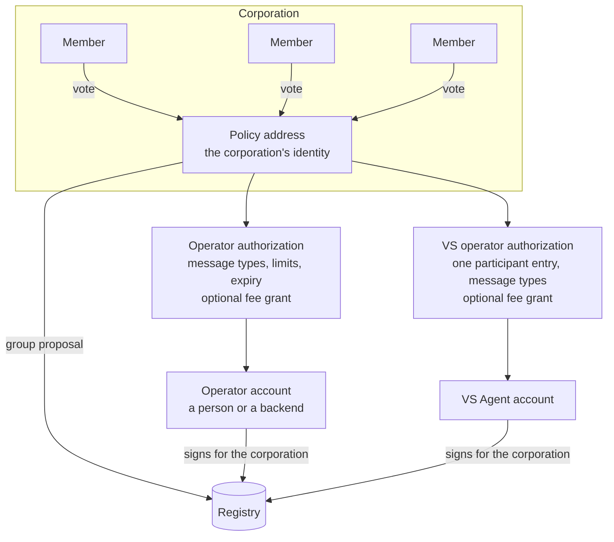

# Corporations and operators

Nothing of value on the registry belongs to a single key. The actor is the corporation: a legal or organisational entity represented on chain by a group of member accounts and a decision policy. The group's policy address is the corporation's identity, and everything the corporation owns, its ecosystems, its accreditations, its trust deposit, points back to it.

## Members and proposals

Members hold voting weight. A decision policy says what it takes to pass: a threshold of weight, or a percentage, within a voting window. The corporation acts by proposal: a member submits a message to execute, members vote, and the policy address executes it. This is how a corporation does the things that must stay in human hands: admit members, change its decision policy, authorise or revoke an operator. A corporation with a single member and a threshold of one is still a corporation; the model scales up without changing shape.

## Operators

Voting on every routine transaction would be impractical, so a corporation delegates. An operator authorization names an account and the exact list of message types it may sign on the corporation's behalf, optionally with a spending limit per period and an expiry. An operator is typically a person at the console, or a backend. The transaction is signed by the operator and executed as the corporation: the registry checks the authorization before anything else.

Operators pay transaction fees themselves unless the corporation grants them a fee grant, which lets them charge the corporation's account within limits.

## Agents as operators

A VS Agent needs a narrower power: to act for one accreditation at a time. When a corporation creates or applies for a participant entry, it can name the agent's account as the VS operator of that entry and list the message types the agent may send for it, typically starting and validating onboarding processes, recording credential sessions, and asking the indexer to re-resolve its DID. This authorization lives and dies with the entry: a revoked, expired or slashed entry disables it. A fee grant can accompany it so the agent never needs to hold funds.

## Why this model

- No single point of compromise: the key that pays fees is not the key that governs, and neither can do what the other does.
- Accountability: every transaction names the corporation it was executed for, and the registry knows which operator signed it.
- Automation with bounds: an agent runs unattended, but only the operations its corporation listed, only for the entries it was named on, only within the budget it was given.

## The corporation's own governance

A corporation publishes its own governance framework, the documents that say how it reaches decisions and who may represent it, versioned like an ecosystem's. The first version is created with the corporation.

## Where next

- [Participant tree and accreditation](./participant-tree-and-accreditation.md): what a corporation holds in an ecosystem.
- Build: [Create a corporation](../../build/ecosystems/index.md); [Let the agent pay with corporation funds](../../build/verifiable-services/index.md).
- Specification: VPR v4, Corporation module, Delegation module, authorization checks.
