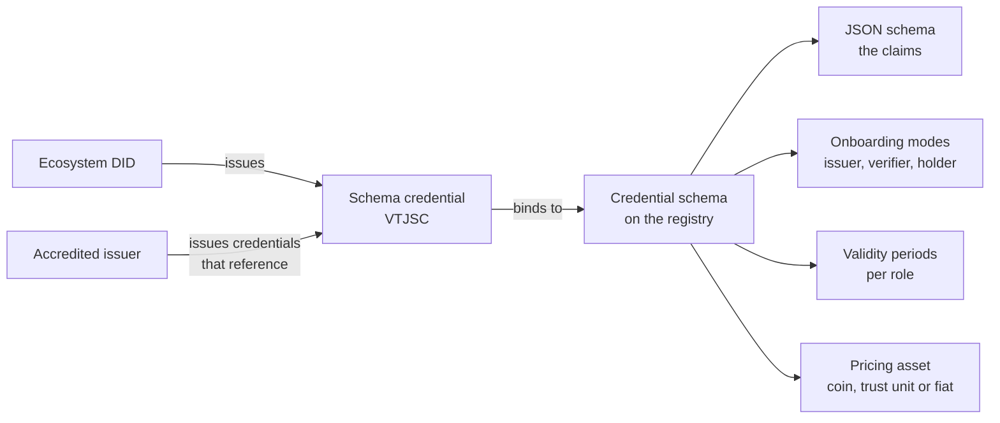

# Credential schemas

A credential schema is what an ecosystem governs. It is a JSON schema, the shape of a credential, together with the policy that says how one becomes its issuer, its verifier or its holder, how long those accreditations last, and in what asset the ecosystem prices them. It belongs to one ecosystem and, once created, its shape and policy never change; only the validity periods can be adjusted. A new shape is a new schema.

## The shape

The JSON schema describes the credential subject: the claims, their types and constraints. The registry stores it canonicalised and immutable, so a verifier can check that a credential conforms to exactly what the ecosystem published. The ecosystem DID then issues a credential about the schema itself, the Verifiable Trust JSON Schema Credential, which carries the registry reference of the schema and its digest. Every credential issued under the schema points to that schema credential, directly for public W3C credentials, through the credential definition for AnonCreds, through the type metadata for SD-JWT. That one link is what lets a verifier walk from any credential to the ecosystem that governs it.

## Onboarding modes

For each role the schema says how an accreditation is obtained:

| Role | Modes |
|---|---|
| Issuer, verifier | **Open**: any corporation self-creates its accreditation, no questions asked. **Ecosystem validation**: the ecosystem itself validates each applicant. **Grantor validation**: accredited grantors validate applicants on the ecosystem's behalf. |
| Holder | **Issuer validation**: the issuer creates an accreditation for each holder, which is how an issuer tracks and later revokes a credential it issued to a service. **Permissionless**: holders need no entry at all, the normal case for credentials issued to people. |

The ECS schemas illustrate the range: the Service schema is open to issuers, because a service may describe itself; the Organization schema requires ecosystem validation, because somebody must verify a legal entity; the Badge schema is open to issuers and permissionless for holders, because a company badges its own people.

## Validity periods

Each role has a validity period in days, zero meaning no expiry. An accreditation obtained through validation lasts that long and must be renewed, which re-enters the validation process. Expiry is one of the ways an ecosystem keeps its tree current.

## Pricing asset

Fees in the ecosystem are expressed in one asset per schema: the network's coin or another coin on the chain, the trust unit (a value-stable unit converted to coin at transaction time), or a fiat currency, in which case the registry records the obligation and settlement happens off chain. Trust deposits are always in the network's coin whatever the pricing asset. The [business model](./business-model.md) page explains the fees themselves.

## Digest algorithm

The schema fixes the hash algorithm used to anchor each public credential on the registry, which is what gives those credentials an objective issuance time.

## Where next

- [Participant tree and accreditation](./participant-tree-and-accreditation.md): the roles the modes refer to.
- Build: [Define a credential schema](../../build/ecosystems/index.md).
- Reference: the [five Essential Credential Schemas](../../reference/credentials/essential-credential-schemas.md) as examples of schemas and their policies.
- Specification: VPR v4, Credential Schema module; Verifiable Trust v4, Verifiable Trust JSON Schema Credential.
