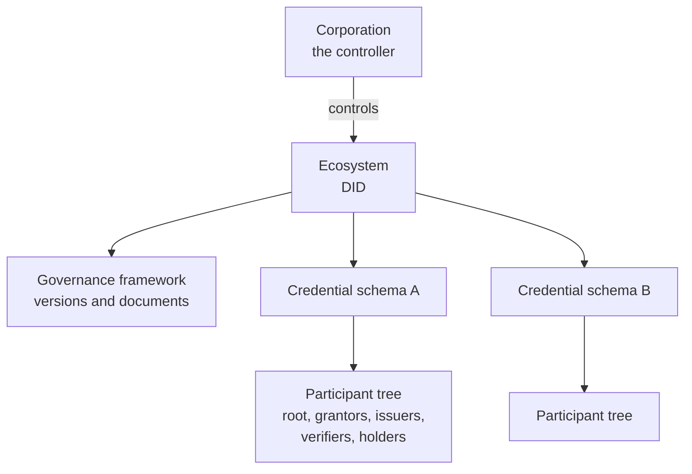

# Ecosystems and governance frameworks

An ecosystem is a domain of trust with an owner. A chamber of commerce that attests companies, a certification body that attests quality systems, a civil registry that attests citizens, a company that attests its authorised repairers: each is an ecosystem. On Verana an ecosystem is a registry entry, controlled by a corporation, that carries a DID, a governance framework, credential schemas, and the tree of participants accredited for them.

Other communities call this a trust registry. Verana reserves "registry" for the shared public ledger, and calls each domain of trust an ecosystem, because that is what it governs: not a list, a set of rules and the parties bound by them.

## The ecosystem DID

The ecosystem DID is the trust root of everything the ecosystem governs. It issues, for each credential schema, the credential that binds the schema on the registry to the ecosystem: the Verifiable Trust JSON Schema Credential. Every credential later issued under that schema points back to it, and every trust resolution ends there. In practice the ecosystem DID is a VS Agent run by the controlling corporation: the anchor service. It publishes those schema credentials automatically when a schema is created.

## The governance framework

The ecosystem governance framework is the written law of the ecosystem: its mission, the credential schemas it governs, how one joins and in which role, what evidence a validator asks for, what it costs, what behaviour gets a participant revoked or slashed, how disputes are handled. The registry holds versions of it, each version with one document per language, identified by URL and content digest so nobody can alter a published text unnoticed. Only the active version binds participants; future versions are prepared and then activated.

The governance framework is a commitment to the participants and to the wallets that will trust the ecosystem's credentials. The Verana Council publishes templates, and the ECS ecosystem's own framework is the first example.

## Who controls an ecosystem

A corporation. It creates the entry, publishes and activates governance framework versions, defines credential schemas, creates the root of each participant tree, and may validate applicants itself or delegate that to grantors. It can rotate the ecosystem DID and archive the ecosystem; an archived ecosystem stays readable and its existing accreditations remain valid until they expire, but no new participant can join.

One corporation can control several ecosystems, and can at the same time be a mere participant in ecosystems it does not control. A company network, for instance, controls the ecosystem of its partners while holding an organization credential from the ECS ecosystem and a certification from a sector body.

## The ECS ecosystem

Every Verana network has one ecosystem that comes first: the ECS ecosystem, which governs the five Essential Credential Schemas that identify services, organisations, personas, user agents and the people behind them. It is governed by the Verana Council, and its accredited issuers are the organisations that verify legal entities. Every other ecosystem relies on it: a participant of any ecosystem is first a Verifiable Service identified through ECS credentials.

## Where next

- [Corporations and operators](./corporations-and-operators.md): who signs for an ecosystem.
- [Credential schemas](./credential-schemas.md): what an ecosystem governs.
- Build: [Ecosystems with the Frontend](../../build/ecosystems/index.md).
- Try it live: the [Vesta story](https://playground.testnet.verana.network/usecases/vesta) follows a company that joins ecosystems and then builds its own.
- Specification: VPR v4, Ecosystem and Governance Framework modules.
