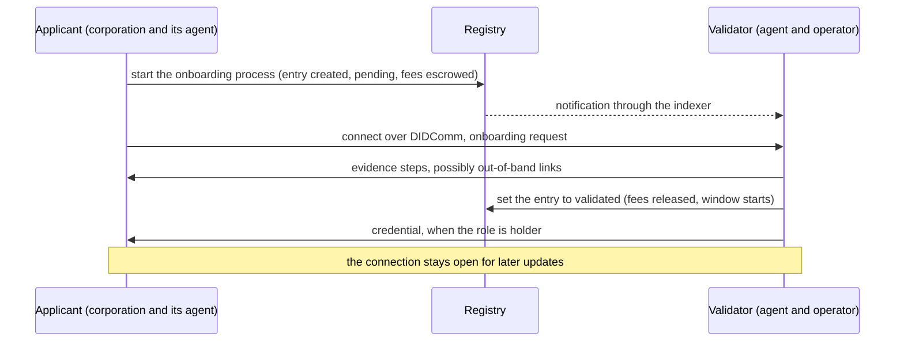

# Onboarding processes

When a schema's mode for a role is not open, an accreditation is obtained through an onboarding process between an applicant and a validator. The applicant is the corporation that wants the role; the validator is the party above it in the tree, the ecosystem, a grantor, or, for holders, an issuer. The registry records the start and the outcome; the evidence travels between the two parties' agents.

## Steps

1. **Application on the registry.** The applicant creates the entry in a pending state, naming the validator and the DID it wants accredited. The validator's fee, plus the applicant's share of trust deposit, is escrowed.
2. **Conversation between agents.** The applicant's agent connects to the validator's agent and sends an onboarding request. The validator checks that a pending entry names it, so the purpose of the connection is established from the registry and not from the peer's word. The governance framework decides what follows: forms, documents, identity checks, each possibly as a link the applicant completes outside the agents.
3. **Validation on the registry.** When satisfied, the validator sets the entry to validated. The escrowed fee is released to the validator, the applicant's trust deposit grows, and the accreditation's window starts.
4. **Issuance, for holders.** When the validated role is holder, the validator issues the credential over the same connection, and the applicant's agent publishes it.

An applicant can cancel its pending request and recover the escrow. An application that is not validated in time expires.

## Renewal

An accreditation with a validity period must be renewed before it ends. Renewal starts a new process with the same validator, the entry stays active meanwhile, and the governance framework says what a renewal requires, which may be less than a first application.

## Who validates

| Schema mode | Validator |
|---|---|
| Ecosystem onboarding process | the ecosystem's root entry, operated by the controlling corporation |
| Grantor onboarding process | an accredited issuer grantor or verifier grantor |
| Issuer onboarding process (holders) | the issuer that will issue the credential |

The validator's side is a workflow in its agent and its frontend: a pending task appears, the operator reviews the evidence the agent collected, and validates or rejects. The applicant's side is handled by its agent once the application is on the registry.

## Where next

- [The business model](./business-model.md): the fees that change hands during an onboarding.
- Build: [Join through an onboarding process](../../build/verifiable-services/index.md); [Validate applicants](../../build/ecosystems/index.md).
- Reference: the [vt-flow protocol](../../reference/vs-agent/vt-flow-protocol.md) that carries the conversation.
- Specification: VPR v4, Participant module; vt-flow protocol 1.0.
