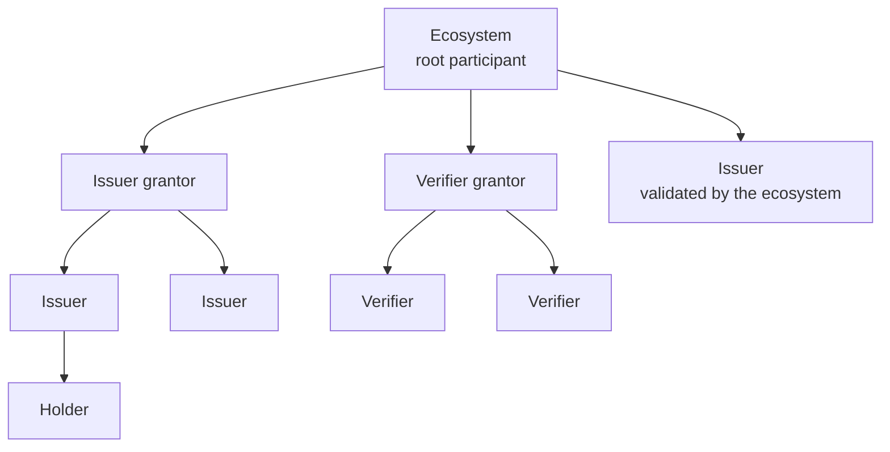

# The participant tree and accreditation

For every credential schema the registry keeps a tree. At the root sits the ecosystem. Below it, the parties the ecosystem has recognised: grantors that onboard others, issuers, verifiers, and for some schemas the holders. Each node is a participant entry, the registry's record of one accreditation: this corporation, with this DID, holds this role for this schema, validated by that parent, from this date to that date.

## Roles

| Role | What the accreditation allows |
|---|---|
| Ecosystem | The root of the schema's tree: validates grantors, or issuers and verifiers directly, and sets the fees at the root. |
| Issuer grantor, verifier grantor | Ecosystem operators that validate issuers (or verifiers) on the ecosystem's behalf, each with their own branch of the tree and their own fees. |
| Issuer | May issue credentials of the schema. Wallets refuse offers from anyone else. |
| Verifier | May request presentation of credentials of the schema. Wallets refuse requests from anyone else. |
| Holder | Holds a credential of the schema. Present only when the schema's holder mode requires it; then the issuer creates and can revoke the entry, which is how a credential issued to a service is revoked. |

The audience word for a participant entry is an accreditation. The word participant is kept where the protocol uses it.

## What an entry carries

An accreditation is about a DID, owned by a corporation. It has an effective window, the dates between which it counts; before the start it is future, after the end it is expired. It can be revoked by its validator, by the ecosystem or by its owner, and it can be slashed when its owner breaks the governance framework. It records the fees its holder charges those below it, and the onboarding state while an application is in progress. An entry is active when its window contains now and it is neither revoked nor slashed. Only active entries count.

## What an accreditation proves, and when

Trust resolution asks whether the issuer of a credential held an active issuer accreditation for the schema at the moment the credential was issued. For public W3C credentials that moment is objective, because the credential's digest was anchored on the registry; an issuer that is later revoked does not retroactively invalidate what it issued while accredited. For private credentials (AnonCreds, SD-JWT) the check is made at the present time, and the wallet checked it at reception.

## Changing the tree

Entries are created by self-creation when the mode is open, by an onboarding process otherwise. They are renewed before expiry, their end date can be moved by the validator, and they are revoked or slashed by the parties the governance framework entitles. A revoked or expired issuer keeps its place in history: the indexer and the graph retain it as long as something references it, so a verifier can still evaluate what was issued under it.

## Where next

- [Onboarding processes](./onboarding-processes.md): how an entry goes from applied to validated.
- Build: [Join an ecosystem](../../build/verifiable-services/index.md); [Root participants and grantors](../../build/ecosystems/index.md).
- Try it live: the playground's [MOSIP showcase](https://playground.testnet.verana.network/usecases/mosip) renders a participant tree.
- Specification: VPR v4, Participant data model and the definition of an active participant.
