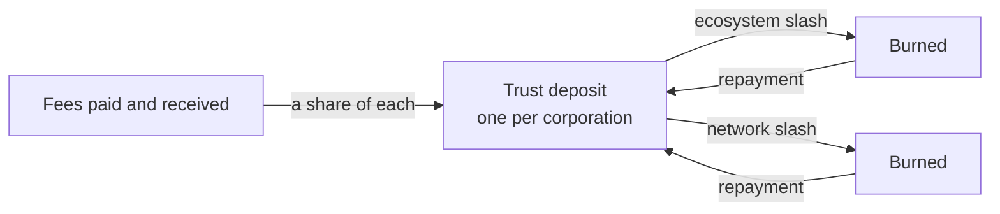

# Trust deposit, slashing and reputation

Every corporation on the registry has one trust deposit. It is not paid in up front; it grows as the corporation acts: a share of every fee it pays and every fee it receives is set aside in it. It cannot be withdrawn in v4. It is the corporation's skin in the game, and it is what an ecosystem or the network can take away when the rules are broken.

## How it grows

Onboarding processes grow the deposits of both applicant and validator. Issuance and verification fees grow the deposits of every party in the tree that received a share, and of the wallets that took part. Registering accreditations grows the deposit of the corporation that executes the transaction. The share is a network parameter, five percent at the time of writing.

## Two levels of slashing

An ecosystem may slash the part of a corporation's deposit that corresponds to its activity in that ecosystem, when the corporation breaks that ecosystem's governance framework. The framework states what is slashable, how harm is assessed, and what chance the participant gets to make amends first. A slashed accreditation stops working until the slashed amount is repaid.

Network governance may slash a corporation's deposit globally for fraud or for breaking the network's governance framework. While a global slash is unrepaid, every accreditation of the corporation is treated as untrustworthy.

Slashed amounts are burned. Repayment is exact and restores the deposit; the slash itself remains in the corporation's history.

## Reputation

Nothing on the registry is a score. Everything needed to compute one is public: the size and age of a deposit, the volume of credentials issued and verified per ecosystem, the accreditations held and lost, every slash and every repayment. A wallet, a graph or an auditor can weigh those as they see fit, and two parties using the same weights reach the same number. The trust graph exposes the inputs; it does not impose the formula.

## Where next

- [Ecosystems and governance frameworks](./ecosystems-and-governance-frameworks.md): where slashing rules are written.
- Build: [Revoke, slash and repay](../../build/ecosystems/index.md).
- Specification: VPR v4, Trust Deposit module and the participant slashing messages.
