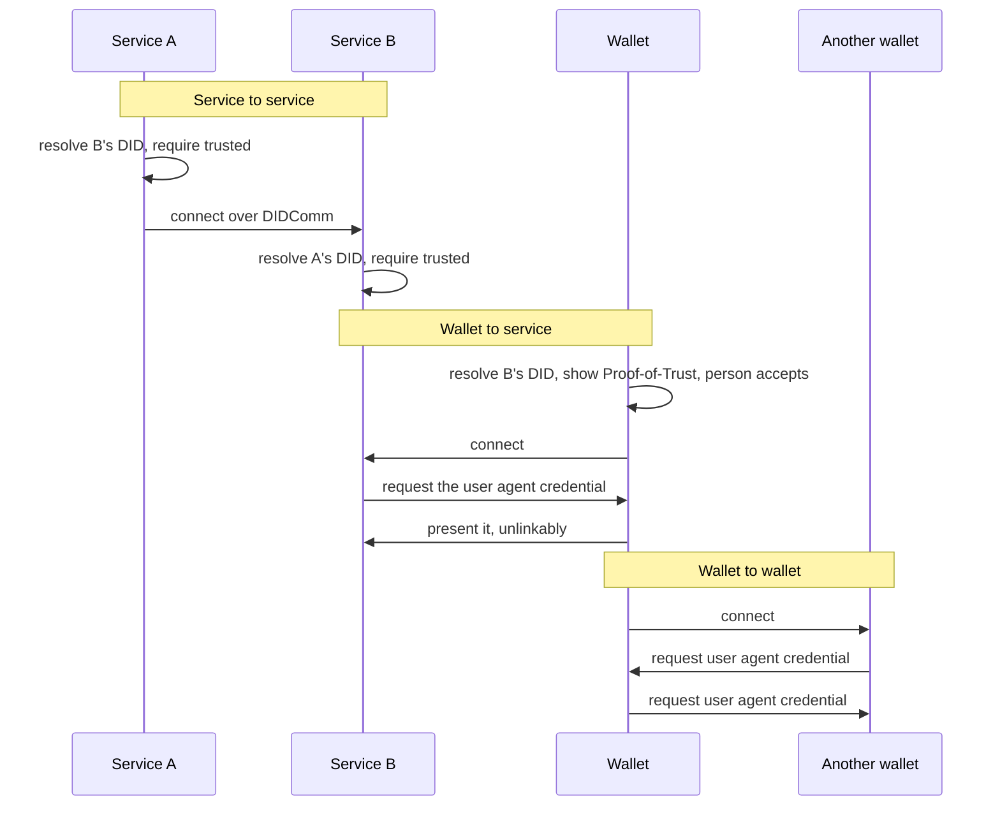

# The three connection flows

Every connection on Verana starts with a verification, and the verification differs by who is on each side.

## Service to service

Both sides resolve the other's DID and connect only on a trusted verdict. The one exception is a validator receiving an applicant that is not yet verifiable, because the purpose of the connection is to make it so: the validator then requires that a pending accreditation on an ECS schema, recorded on the registry, names it as validator. Once connected, a service that wants to issue or verify must be accredited for the schema, and the other side checks.

## Wallet to service

The wallet resolves the service, shows the Proof-of-Trust, and connects only after the person accepts. The service, in turn, asks the wallet to present its ECS User Agent credential before serving anything, and may additionally ask for a Badge to identify the person and whom they represent. Offers and requests that follow are checked against the service's accreditations.

## Wallet to wallet

Two user agents each request the other's user agent credential, and the channel opens only when both have verified. No service is involved; what each side learns is which software it talks to, not who the person is.

## Over OpenID4VC

Wallets on the bridge track have no DIDComm connection to resolve before. They resolve the issuer's DID when a credential offer arrives and the verifier's DID when a presentation request arrives, and show the Proof-of-Trust inside their consent screen before the person can accept.

## Where next

- [Verifiable AI agents](./verifiable-ai-agents.md): the same flows between agents.
- Build: [Verify a peer before you connect](../../build/verifiable-services/index.md).
- Specification: Verifiable Trust v4, `VS-CONN-VS`, `VS-CONN-VUA`, `VUA-CONN-VS`, `VUA-CONN-VUA`.
