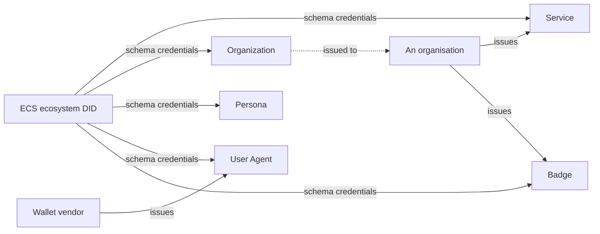

# Essential Credential Schemas

Before an ecosystem can govern anything, somebody has to answer the basic questions: what is this service, who operates it, is this user agent genuine, who is the person behind it. The Essential Credential Schemas are the five schemas that answer them. They are governed by the ECS ecosystem, the first ecosystem on every Verana network, under the Verana Council.

| Schema | Identifies | Public or private | Who issues |
|---|---|---|---|
| Service | a Verifiable Service: name, type, description, logo, minimum age, terms, privacy policy | public, in the DID Document | the organisation behind the service; the schema is open to issuers |
| Organization | the legal entity operating services: name, logo, registry identifier, address, country, optional jurisdiction and LEI | public | accredited ECS issuers, after verifying the entity |
| Persona | a human-controlled persona operating services, the alternative to Organization | public | accredited ECS issuers |
| User Agent | an instance of wallet or agent software and its version; the issuer identifies the product line | private, AnonCreds | accredited wallet vendors |
| Badge | a human: badge number, name, photo, optional title, department, birth date, biometric template; the issuer identifies whom they represent | private, AnonCreds | any Verifiable Service, for its own people; the schema is open to issuers and permissionless for holders |

## Public and private

Service, Organization and Persona credentials are W3C credentials published as linked presentations in DID Documents: anyone resolving the DID sees them, which is the point. User Agent and Badge credentials are AnonCreds credentials held by instances and by people, presented over DIDComm with selective disclosure and unlinkable proofs, and never declared in a DID Document: a person's badge is shown to the service that asks, not to the world.

## How they chain

A Badge is trusted because its issuer is trust-resolved: the issuer is a Verifiable Service, which presents a Service credential, which leads to an Organization credential, which was issued by an accredited ECS issuer, which the ECS ecosystem accredited. The Badge's title and department are facts about the person, not authorizations: the authorization is the issuer's.

## Reserved fragments

The ECS ecosystem publishes one schema credential per ECS under fixed DID Document fragments, and services publish their Service, Organization and Persona credentials under fixed fragments too. The fixed names are what let a resolver find them without guessing.

## Where next

- [Verifiable Trust Credentials](./verifiable-trust-credentials.md): the formats these schemas use.
- Reference: the [five schemas, claim by claim](../../reference/credentials/essential-credential-schemas.md).
- Build: [Become trusted](../../build/verifiable-services/index.md).
- Specification: Verifiable Trust v4, Essential Credential Schemas.
