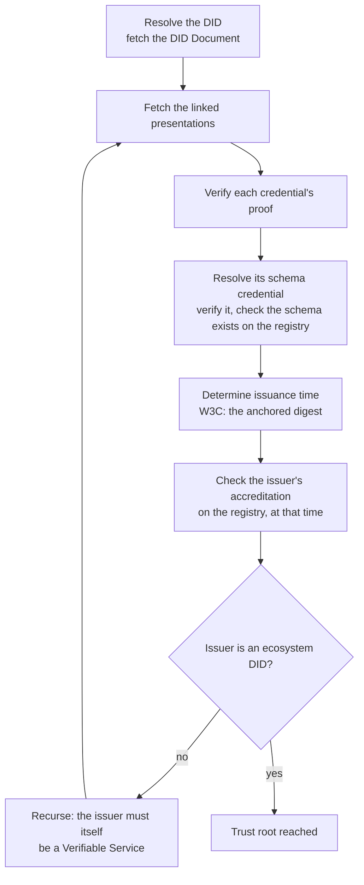

# Trust resolution and Proof-of-Trust

Trust resolution turns a DID into a decision. Given the DID of a service, it verifies the credentials the service presents, checks on the registry that each issuer was accredited to issue them, and does the same for each issuer in turn, until it reaches an ecosystem DID. If every step holds, the service is trusted and a Proof-of-Trust can be shown. If any step fails, the service is not.

## The steps, in words

1. Resolve the DID and read its DID Document: the linked presentations and the endpoints.
2. Verify each presented credential cryptographically: a signature for W3C, a proof for AnonCreds, the issuer-signed token and the key binding for SD-JWT.
3. Resolve the schema credential each credential references, verify it, and confirm that an ecosystem DID issued it and that it binds to a schema that exists on the registry.
4. For W3C credentials, recompute the digest and find it on the registry: its block time is the issuance time.
5. Check on the registry that the issuer held an active issuer accreditation for that schema, at the issuance time for W3C credentials, now for the others.
6. Every issuer met along the way must itself be a Verifiable Service: resolve it and repeat. The recursion ends at the ecosystem DID, which issued the schema credential and is the trust root.
7. One failure anywhere fails the whole resolution.

## What the result says

A trusted verdict means: this DID presents a valid Service credential, and either it or the issuer of that Service credential presents exactly one valid Organization or Persona credential, and every link back to the ECS ecosystem holds. The verdict carries the moment it was evaluated and the moment it stops being valid: the earliest expiry among the credentials and accreditations involved. Crossing that moment means the DID is genuinely no longer trustable, not that a cache went stale.

Beyond the verdict, resolution yields the claims of the identity credentials, the other credentials the service presents with their own verdicts, the accreditations the DID holds, and the endpoints it declares. That is the material of a Proof-of-Trust.

## Where it runs

Resolution is deterministic and anyone can run it from public data. In practice three places do:

- **The indexer** resolves every DID it finds and keeps the verdicts current, re-evaluating when a transaction touches the DID or when the service asks it to. Wallets, the frontend and the graph read its answers.
- **The VS Agent** resolves peers before accepting connections and credentials, caching positive answers briefly and never negative ones.
- **A wallet** resolves through an indexer, public or self-hosted, and shows the result.

The registry itself never resolves anything. It stores the facts resolution relies on.

## Where next

- [The three connection flows](./connection-flows.md): when resolution happens.
- Reference: the indexer's [resolve endpoint](../../reference/indexer-api/index.md).
- Try it live: every card on the [playground](https://playground.testnet.verana.network) is a live resolution.
- Specification: Verifiable Trust v4, `TR`; Indexer v4, trust evaluation lifecycle.
