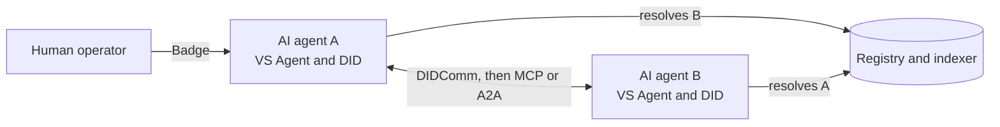

# Verifiable AI agents

An AI agent that talks to other agents and services has the same problem as any service, and worse: it acts fast, it acts for someone, and it is easy to impersonate. Verana treats an AI agent as a Verifiable Service. Nothing in the model is specific to agents; what is specific is how much it matters.

## Identity before connection

An agent's DID Document says what the agent is and who operates it, through the same ECS credentials as any service. Another agent resolves it before connecting and refuses an untrusted peer. The operator is a verified organisation or persona, not a model name or an API key.

## Accreditation for what it does

What an agent may do is written as accreditations: it is an accredited issuer or verifier of specific credentials in specific ecosystems. An agent offering to verify a KYC credential proves, on the registry, that the ecosystem that governs that credential accredited it. The counterpart's wallet or agent checks, and refuses otherwise.

## The people behind the agent

Badges identify the humans who operate or supervise an agent, issued by the organisation that stands behind them. A service that requires a human in the loop can ask the agent's user agent for a Badge and know whom it represents.

## Endpoints after trust

An agent declares its MCP or A2A endpoints in its DID Document next to its DIDComm endpoint. A peer resolves trust first, obtains whatever token the endpoint needs over DIDComm, and only then calls the MCP or A2A endpoint. Trust gates the protocol; the protocol does not have to carry it.

## Discovery

Agents find counterparts through the trust graph, by what they prove rather than what they claim: an issuer recognised by a given ecosystem, a service whose operator is a verified company in a given country, an agent that holds a given certification. The Verana MCP server exposes those queries, and the registry operations, as tools to any MCP client.

## Outlook

Delegation is the next layer: durable, registry-anchored authorization for what an operator's agents may do in an ecosystem, combined with per-action consent from an accountable human at the agent runtime. The registry answers "is this agent's operator authorised here at all"; the consent gate answers "did a human approve this specific action".

## Where next

- [MCP and AI discovery](../discovery/mcp.md).
- Build: [Build an AI agent as a Verifiable Service](../../build/verifiable-services/index.md); [AI agents and MCP](../../build/ai-agents-mcp/index.md).
- Specification: Verifiable Trust v4, `VS-SVC-3` and `VS-SVC-7`; verana-spec roadmap.
