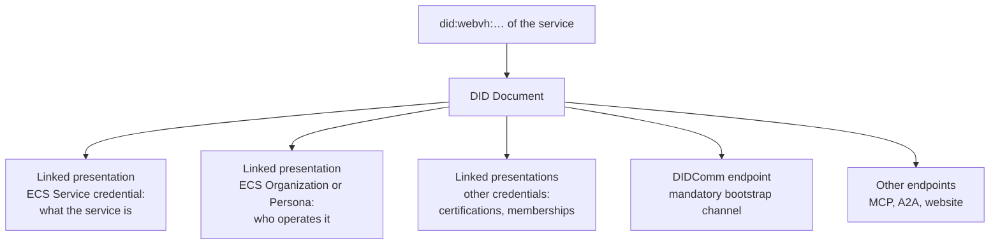
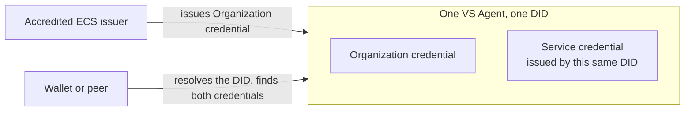
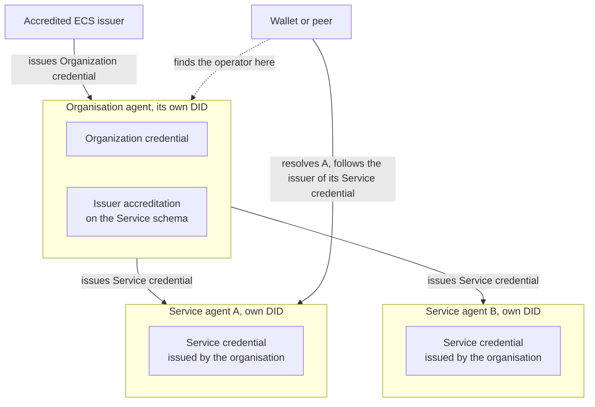

# Verifiable Services

A Verifiable Service is a service, an API, a chatbot, a web portal, an AI agent, that can be verified before anyone connects to it. It is identified by a DID that resolves to a DID Document, and that document is where the proof lives: the credentials the service presents about itself, and the endpoints through which it is reached.

## What a Verifiable Service proves

Three things, in this order of resolution:

- **What it is**: an ECS Service credential, with its name, type, description, logo, minimum age, terms and privacy policy.
- **Who operates it**: exactly one ECS Organization or ECS Persona credential, presented by the service itself when it issued its own Service credential, or by the issuer of that Service credential otherwise. Either way, every service ends at an accountable legal entity or natural person.
- **What it is accredited for**: not in the document but on the registry, where its accreditations say which credentials it may issue and verify, under which ecosystems.

The identity credentials come from the ECS ecosystem. An organization or persona credential is obtained once, through an onboarding process with an accredited ECS issuer that verifies the entity. A service credential is issued by the organisation itself, since the Service schema is open to issuers: once an organisation is verified, it may describe its own services.

## Endpoints

A Verifiable Service declares at least one DIDComm endpoint. DIDComm is the bootstrap channel: it is where trust is established between two parties and where the credentials, tokens or keys needed for the other endpoints are obtained. Any other endpoint, an MCP server, an A2A endpoint, a website, may be declared too, and a peer uses it only after trust resolution of the DID succeeded. In practice DIDComm is the control plane of a Verifiable Service and the other endpoints are its data plane.

## What a Verifiable Service does

It verifies the trust of every peer before serving it. A connecting service must itself be a Verifiable Service; a connecting wallet must present a user agent credential.

:::warning Not yet enforced: the user agent credential
The specification requires a wallet to present its ECS User Agent credential before a service serves it, and two wallets to exchange theirs before they talk. Neither is enforced today: VS Agent does not request the credential from connecting wallets, and wallet-to-wallet connections do not check it either, because the issuance of User Agent credentials by wallet vendors is not yet generally available. Services currently rely on the trust decisions around credentials (who may issue, who may verify); the user agent check is added when the issuance infrastructure ships.
::: It issues credentials only under schemas it is accredited for, requests presentations only of credentials it is accredited to verify, and it refuses offers and requests from peers that are not. Those are not courtesies: wallets and peer services enforce the same rules from their side, so an unaccredited offer is refused twice.

## Two patterns

**One agent, one DID.** The organisation and its single service share a DID. The agent obtains the organization credential and issues its own service credential. Right for a first deployment or a single-service company.

**Organisation and child services.** An organisation agent holds the organization credential and an issuer accreditation on the Service schema, and issues a Service credential to each child service, which runs its own agent and DID. Trust resolution of a child reaches the parent through the issuer of its Service credential. Right for several services, separate keys, and services that come and go.

## Where next

- [VS Agent](./vs-agent.md): the runtime that implements all of this.
- [Trust resolution](./trust-resolution.md): what a peer does with the DID Document.
- Build: [Verifiable Services with VS Agent](../../build/verifiable-services/index.md).
- Try it live: resolve a real service on the playground's [identity page](https://playground.testnet.verana.network/personal-wallets).
- Specification: Verifiable Trust v4, `VS-REQ` and `VS-SVC`.
