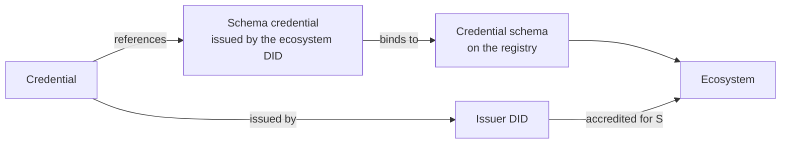

# Verifiable Trust Credentials

A Verifiable Trust Credential is a credential that can be traced to an ecosystem on the registry. The trace runs through one object: the schema credential the ecosystem DID issued about the credential schema. Any credential that points to it, directly or indirectly, lets a verifier find the schema, the ecosystem, the issuer's accreditation, and so decide.

## Three formats

**W3C JSON-LD.** The format of everything public about services: ECS Service, Organization and Persona credentials, schema credentials, certifications a service publishes. The subject is a DID. The credential is published as a linked presentation in the DID Document. Its issuance time is objective: the issuer anchors the credential's digest on the registry, and the block time of that anchor is when it was issued, which is what the issuer's accreditation is checked against. Issued over vt-flow and DIDComm between agents.

**AnonCreds.** The format of private credentials on the DIDComm rail: ECS User Agent and ECS Badge for DIDComm wallets, and any credential where unlinkability matters. No subject DID; presentations prove claims without revealing the credential. Selective disclosure and predicates (over eighteen without the birth date). Revocation through registries. Exchanged over DIDComm. The link to the schema runs through the credential definition, which names the schema credential.

**SD-JWT VC.** The format of OpenID4VC, the rail European-style wallets speak. Selective disclosure by design, holder binding, revocation through Token Status Lists signed by the issuer. The link to the schema runs through type metadata that the ecosystem anchor serves for each schema and that every accredited issuer references, so wallets of different vendors agree on the type.

## Which one when

| Need | Format |
|---|---|
| Say something public about a service or an organisation | W3C JSON-LD |
| Identify software or people privately, unlinkably | AnonCreds |
| ECS User Agent or Badge on an OpenID4VC wallet | SD-JWT VC |
| Reach wallets built on OpenID4VC | SD-JWT VC |
| Both wallet populations | issue the same schema over both rails; the playground does |

## What stays the same across formats

The issuer must hold an active accreditation for the schema, the credential must reference the ecosystem's schema credential, and the wallet checks both at reception while the verifier checks them again at presentation. The formats differ in how private the credential is and in when the issuer's accreditation is evaluated: at anchored issuance time for W3C, at the present time for the two private formats.

## Where next

- [Trust resolution](./trust-resolution.md): how a verifier walks the chain.
- Reference: [Credential formats](../../reference/credentials/formats.md) side by side.
- Build: [Issue credentials](../../build/verifiable-services/index.md).
- Specification: Verifiable Trust v4, `VT-CRED-W3C`, `VT-CRED-ANON`, `VT-CRED-SDJWT`.
