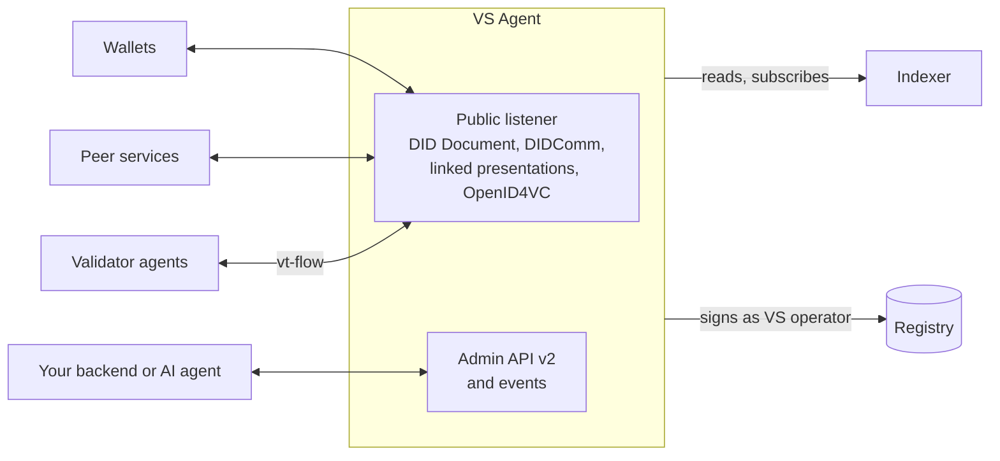

# VS Agent

VS Agent is the runtime an organisation deploys next to each service it wants to make verifiable. The service keeps its business logic; the agent takes care of everything the Verifiable Trust model requires: identity, credentials, trust decisions, protocols, and the registry operations the corporation authorises it for. In European terms it is a business wallet; it is also a DIDComm agent, an OpenID4VC issuer and verifier, an AnonCreds registry and a registry operator.

## What it does for you

- **Identity.** Creates the DID (did:webvh by default, did:web on request) from the public URL, holds the keys, publishes and maintains the DID Document.
- **Credentials.** Obtains the ECS credentials through onboarding flows or issues its own Service credential, publishes them as linked presentations, keeps them consistent with its store, removes them on revocation.
- **Trust decisions.** Resolves every peer before accepting a connection, and runs the full trust decision on every credential it receives, failing closed.
- **Protocols.** DIDComm v1 and v2 with the standard protocols (connections, messages, present proof, issue credential, and optional ones), OpenID4VCI and OpenID4VP with SD-JWT VC and status lists, AnonCreds with revocation.
- **Flows.** The applicant and the validator side of vt-flow: onboarding processes, direct issuance, issuance after validation, revocation updates.
- **Ecosystem anchor.** When its DID is an ecosystem's DID, it publishes the schema credentials, the SD-JWT type metadata and the AnonCreds schema for every credential schema the ecosystem creates, automatically.
- **Registry operations.** Signs, under its VS operator authorization, the transactions its corporation listed: start and validate onboarding processes, record sessions, anchor digests, trigger re-resolution.

## Interfaces

| Interface | Who uses it | Nature |
|---|---|---|
| Public listener | wallets, peer services, resolvers | DID Document, DIDComm, linked presentations, AnonCreds registry, OpenID4VC endpoints, short invitation URLs |
| Admin API v2 | your backend, the MCP server, an operator console | REST, versioned, authenticated by trusted network or by corporation account |
| Events | your backend | one webhook, one JSON envelope per state change |
| Indexer and registry | the agent itself | reads state and subscribes to events through the indexer, broadcasts transactions to a node |

## Deployment

One container per agent, with a PostgreSQL database and Redis. It needs a stable public HTTPS origin, because the DID is derived from it, and a network path to a node and an indexer. Docker Compose on one host or a Helm chart on Kubernetes; the configuration is environment variables. Two modes: standalone, where the agent is an organisation with its own identity credential, and delegated, where a parent Verifiable Service issues its Service credential.

## What it is not

It is not a personal wallet, and it does not store people's credentials. It is not a chain node or an indexer, though it depends on both. It does not contain your business logic: your backend decides what to issue and to whom, when to accept, what to do with a verified presentation; the agent makes those actions verifiable.

## Where next

- Build: [Verifiable Services with VS Agent](../../build/verifiable-services/index.md), starting with the quickstart.
- Reference: [VS Agent](../../reference/vs-agent/index.md).
- Specification: [VS Agent v4](https://github.com/verana-labs/verana-spec/blob/main/v4/vs-agent/spec.md).
