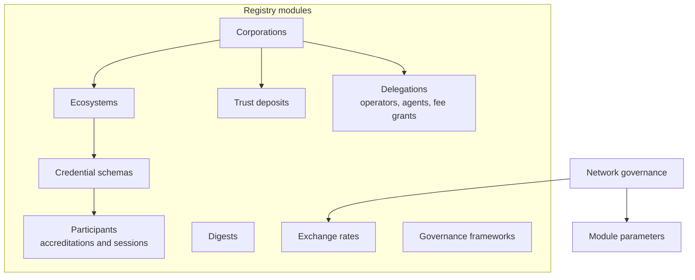

# The Verifiable Public Registry

A Verifiable Public Registry is a public ledger that holds the facts trust decisions rely on: who the corporations are, which ecosystems they control, which schemas those govern, who is accredited for what and when, what each corporation has at stake, and the fees and exchange rates of the business model. The Verana network is the first implementation, a blockchain built with the Cosmos SDK.

## What is on chain

Registrations and their history. A corporation and its group. An ecosystem and the versions of its governance framework by URL and digest. A credential schema, canonical and immutable. Each accreditation with its window, fees and state. Each trust deposit, slash and repayment. Each operator and agent authorization. Each anchored digest with its block time. Each exchange rate. The chain knows nothing about DID Documents or credentials beyond a digest and a DID string.

## What is deliberately not on chain

Verification. The registry never resolves a DID, never fetches a credential, never decides whether something is trustworthy. That is done by indexers, agents and wallets from the public facts. It keeps the registry neutral about DID methods and credential formats, cheap to run, and impossible to use as an oracle that could be wrong.

## Digests

The one content the registry anchors is a hash. An issuer anchors the digest of each public credential it issues, and the block time of that digest becomes the credential's objective issuance time, the moment at which the issuer's accreditation is checked. The same primitive anchors any document whose existence at a time must be provable: a governance framework, terms of service, an audit report.

## Governance

Module parameters, the exchange rate lifecycle and network-level slashing are governance decisions, made by proposal and vote among the network's validators and token holders. The parameters that shape the business model, the trust deposit rate, the wallet and user agent reward rates, the maximum validity periods, are among them. The Verana Council, a body of founding organisations, governs the network and the ECS ecosystem.

## Accounts and fees

Transactions cost network fees in the network's coin, paid by the signer or by a corporation through a fee grant. Business fees between participants are a separate matter, settled by the registry in the asset each schema chooses.

## Where next

- [Environments](./environments.md): the networks you can use.
- Reference: [Message catalog](../../reference/network/message-catalog.md); [Network parameters](../../reference/network/parameters.md).
- Build: [Run the infrastructure](../../build/run-infrastructure/index.md).
- Specification: [Verifiable Public Registry v4](https://verana-labs.github.io/verifiable-trust-vpr-spec/versions/v4/).
