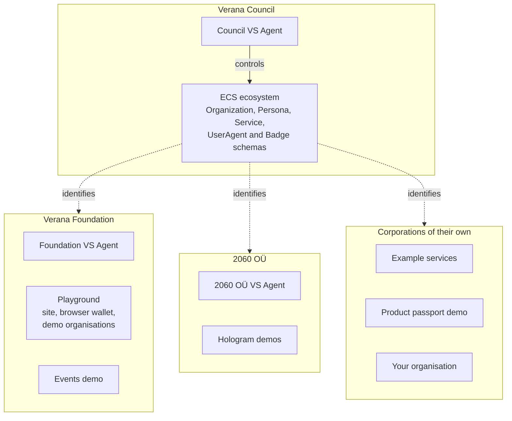
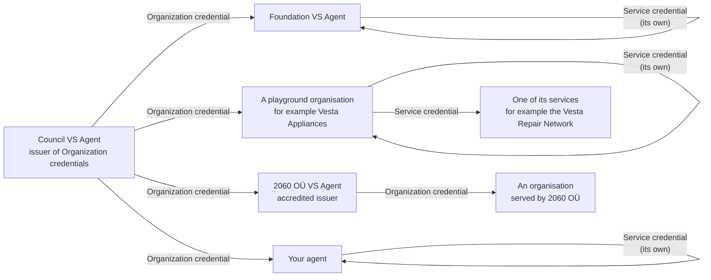
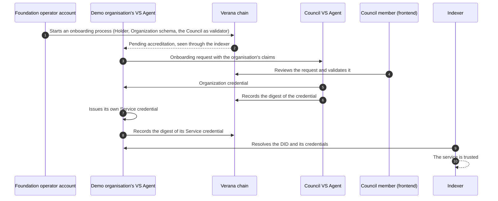

# Who runs what on devnet and testnet

Devnet and testnet come with services already running: an ECS ecosystem that identifies organisations, a playground, several demos. None of them is special to the chain. Each one belongs to a [corporation](../ecosystems/corporations-and-operators.md), like anything you deploy yourself, and follows the same rules.

This page says which corporation owns what, who issues the identity credentials, and how your own service gets its Organization credential on these networks.

## Three corporations

| Corporation | devnet | testnet | What it does on the network |
|---|---|---|---|
| **Verana Council** | 16 | 40 | Controls the ECS ecosystem. Issues ECS Organization credentials. |
| **Verana Foundation** | 17 | 41 | Owns the playground and the demos of its working groups. |
| **2060 OÜ** | 18 | 42 | Owns the Hologram demos. An accredited issuer of ECS Organization credentials. |

The numbers are the corporation ids on chain. A corporation is not tied to one service: it owns any number of DIDs, ecosystems, schemas and participant entries. That is why the whole playground, with its dozens of fictional organisations, is one corporation.

## The Council and the ECS ecosystem

The [Essential Credential Schemas](../identity/essential-credential-schemas.md) answer the first question of [trust resolution](../identity/trust-resolution.md): who operates this service? On devnet and testnet the ecosystem that governs them is the Council's.

- **One agent is the anchor.** The Council's VS Agent is the DID of the ECS ecosystem. It publishes the five schemas, and every wallet, agent and indexer that trusts this network lists its DID as a trusted ECS ecosystem.
- **It issues Organization credentials.** The same agent holds the Issuer accreditation on the Organization schema. It delivers the credential that says which legal organisation operates a service.
- **A person validates every request.** A Council member reviews each onboarding request in the Verana frontend and validates it there. No script approves an organisation.
- **It can accredit other issuers.** 2060 OÜ is one: its agent also issues Organization credentials, to the organisations it serves.
- **Service credentials are not its job.** An organisation issues the Service credential of each of its own services.

| | devnet | testnet |
|---|---|---|
| Council VS Agent | `https://council.devnet.verana.network` | `https://council.testnet.verana.network` |
| ECS ecosystem DID | `did:webvh:QmS9A72aycFgQV18yAQ5yByhFuuAw4CWmCMfskd8YzczwG:council.devnet.verana.network` | `did:webvh:QmaG8Zk91utJCRpHZ6ruVKwedNEWXUm1vnXvttf6pENZHM:council.testnet.verana.network` |
| Corporation address | `verana1jc4mtk0g8ulmvhwmpfy5rrj7rwn85ual4p3w0tlwnp2rsauvf5eq02r5m0` | `verana1nk69cxt998w084ushqzfzlkn907kyne0vl25gvqy2twd86t728vqefqhfa` |
| ECS ecosystem id | 10 | 27 |
| Organization schema id | 12 | 36 |
| Persona schema id | 13 | 37 |
| Service schema id | 14 | 38 |
| UserAgent schema id | 15 | 39 |
| Badge schema id | 16 | 40 |
| In the frontend | [app.devnet.verana.network/ecosystems/10](https://app.devnet.verana.network/ecosystems/10) | [app.testnet.verana.network/ecosystems/27](https://app.testnet.verana.network/ecosystems/27) |

No issuer is accredited on the Persona schema yet. A service operated by a person cannot get a Persona credential on these networks today.

### Who issues which credential

Two rules explain the picture:

1. **The Organization credential comes from an accredited issuer.** Nobody declares its own legal identity.
2. **The Service credential comes from the organisation.** An agent that holds an Organization credential issues its own Service credential, and the Service credential of each [child service](../../build/verifiable-services/22-child-services.mdx) it operates.

## The Foundation and its playground

The Verana Foundation is an organisation like any other on the network: it has a corporation, a VS Agent, and an Organization credential that the Council issued after a member validated the request.

| | devnet | testnet |
|---|---|---|
| Foundation VS Agent | `https://foundation.devnet.verana.network` | `https://foundation.testnet.verana.network` |
| Foundation DID | `did:webvh:Qma1EyBguZS7v4LYPECKGbHUoadNVq97ZapYH9fcLr2ShN:foundation.devnet.verana.network` | `did:webvh:QmciVJyb9p7ngnnorEz7pJAHuDNotUBJbk3JMa5fYdzEVA:foundation.testnet.verana.network` |
| Corporation address | `verana1mqevjln5hxv3qgd3c4m5zjeeand5hkc7r33ty82fjukw9shxjh6sczryfr` | `verana1pewneqv0ek6ymynzqeh06mw3hh5p53tv7028s76wz3lgdzhyvxwssd0p5d` |

The [playground](https://playground.testnet.verana.network) runs on testnet only. Everything in it is a resource of the Foundation's corporation:

- **The demo organisations.** Vesta Appliances, the Republic of Verandia, the hiring and exchange stories, the accredited and unaccredited demo services: each is a VS Agent with its own DID. They are fictional, and they say so in their name: "(demo)".
- **Their ecosystems and schemas.** The Vesta Repair Network, the ISO certification registry, the Verandian registries and the others are ecosystems that the Foundation's corporation controls.
- **Their accreditations.** Every Issuer, Verifier and Holder entry of the stories belongs to the Foundation's corporation.

The demo organisations are fictional, the trust is not. Each one went through the same path as a real organisation:

The stories then show what goes wrong when a step is missing. The untrusted demo services never got an Organization credential. The unaccredited ones are identified, but hold no Issuer or Verifier accreditation on the schema they use. A wallet tells these cases apart from the registry alone.

## The other demos

| Demo | Network | Corporation | Where |
|---|---|---|---|
| Playground | testnet | Verana Foundation | [playground.testnet.verana.network](https://playground.testnet.verana.network) |
| Events demo: a ticket as a credential, from registration to the door | testnet | Verana Foundation | [eventos.demos.verana.network](https://eventos.demos.verana.network) |
| Hologram demos: avatar and passport credentials, agents that sign users in with them | devnet and testnet | 2060 OÜ | [hologram.zone](https://hologram.zone) |
| Example services: one organisation with issuer and verifier services, as a starting point for your own | devnet | its own | [verana-labs/verana-demos](https://github.com/verana-labs/verana-demos) |
| Digital product passport demo | testnet | its own | [verana-labs/demo-dpp](https://github.com/verana-labs/demo-dpp) |

A demo with a corporation of its own got its Organization credential the way you will.

## Get your Organization credential on devnet or testnet

Anyone can ask. The Council issues Organization credentials on both networks, charges no validation fee, and a Council member validates each request by hand.

1. **Create your corporation and fund it.** See [Create a corporation](../../build/ecosystems/10-create-corporation.md). The coin is free from the faucet.
2. **Run your agent in standalone mode.** Set `TRUSTED_ECS_ECOSYSTEM_DIDS` to the ECS ecosystem DID of the network (the table above) and the organisation claims (`ECS_CLAIMS_ORG_*`). See [Configuration](../../build/verifiable-services/17-configuration.mdx).
3. **Start the onboarding process.** In the frontend, **Discover & Join**, open the ECS ecosystem, select the **Organization** schema and the role **Holder**, and choose the Verana Council as validator. Enter your agent's DID and set your agent's account as VS operator.
4. **Wait for a Council member.** Your agent sends the request by itself. A member sees your DID and the claims your agent sent, and validates the request in the frontend. This is a manual step, so it is not instant. If the request stays pending, ask on the [Verana Discord](https://discord.gg/edjaFn252q).
5. **Check the result.** Your agent receives the credential, publishes it in its DID Document, and issues its own Service credential. See [Check that your service is trusted](../../build/verifiable-services/23-check-trusted.mdx).

The full walkthrough, with the flow states and the troubleshooting table, is [Obtain your ECS Organization or Persona credential](../../build/verifiable-services/20-ecs-organization-credential.mdx).

:::tip Use a square logo
The Verana app and the search show a credential's logo in a square or a circle, and crop any other shape. The credential carries the digest of the image, so changing the file later means a new credential: publish the new image under a new name.
:::

## Where next

- [Environments](./environments.md): what each network is for.
- [Corporations and operators](../ecosystems/corporations-and-operators.md): how one corporation owns many services.
- [Onboarding processes](../ecosystems/onboarding-processes.md): what a validator does, and who pays what.
- Build: [Environments and endpoints](../../build/run-infrastructure/environments/10-environments.md).
