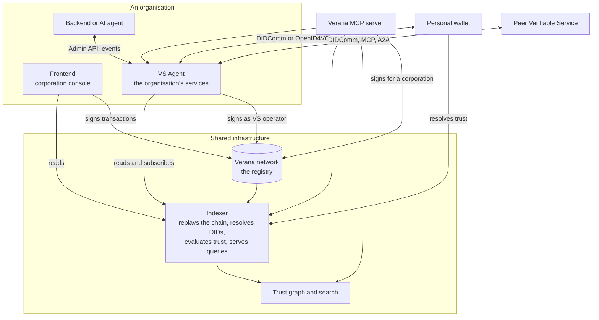

# How the pieces fit

Seven kinds of components make up a Verana deployment. Three are shared infrastructure that anyone can run; the others belong to the organisations and people that use the network.

## The registry

The Verana network is the Verifiable Public Registry: a Cosmos SDK blockchain whose modules hold corporations, ecosystems and their governance frameworks, credential schemas, participant entries (the accreditations), trust deposits, delegations, content digests and exchange rates. It stores registrations, not verifications: it never resolves a DID or checks a credential. That keeps it neutral about DID methods and credential formats, and keeps verification where it belongs, with the relying party.

Nobody signs transactions as a bare account for long. A corporation is a group of accounts with a decision policy; it authorises operator accounts and agent accounts to act for it, each for a precise list of message types, optionally with a fee grant so the corporation pays.

## The indexer

The indexer replays every block, keeps the history of every entity, and does the work the chain refuses to do: it resolves the DIDs it finds, fetches their linked presentations, verifies the credentials, checks each issuer's accreditation at the right time, and records a trust verdict per DID with the moment it expires. It serves all of this over REST and over a WebSocket stream of events, and answers the ToIP Trust Registry Query Protocol. In v4 the former standalone resolver lives inside it.

Everything else reads the chain through an indexer. Agents, the frontend and the MCP server never query the node for state; they only broadcast transactions to it.

## The trust graph

The graph ingests the indexer and turns it into a queryable network of DIDs, corporations, ecosystems, schemas, endpoints and credentials, with edges for ownership, accreditation, issuance and validation. It answers ranked faceted searches and a fixed set of traversal queries, trusted-only by default. The search UI and the discovery tools of the MCP server sit on top of it.

## VS Agent

VS Agent is the runtime an organisation deploys for each service or AI agent it wants to make verifiable. It owns the service's DID and keys, publishes the DID Document and the linked presentations, speaks DIDComm with peers and wallets, serves OpenID4VC issuance and verification, acts as the AnonCreds registry for the credentials it issues, runs the onboarding and issuance flows with validators, resolves trust before accepting a connection, and signs the registry transactions its corporation has authorised it for. A backend drives it through the Admin API and listens to its events; the business logic stays in the backend.

Patterns: one agent that is both the organisation and its only service, or an organisation agent that issues Service credentials to several child agents, each with its own DID.

## Personal wallets

A personal wallet, a mobile identity wallet, a DIDComm messenger or an agentic browser, holds a person's credentials and talks to Verifiable Services. A Verana-integrated wallet asks the indexer three questions at the right moments: is this service trusted and who operates it, may it issue this credential, may it ask for this credential. It shows the answer as a Proof-of-Trust before the person accepts anything. Wallets that speak DIDComm connect natively; wallets built on OpenID4VC keep their stack and add trust resolution around their consent screens.

## The frontend

The frontend is the console of a corporation: its members and operators, its ecosystems and governance frameworks, its credential schemas, the participants it accredits, its trust deposit, its pending validations. It reads from the indexer and signs transactions with the user's browser wallet. It does not run services; that is the agent's job.

## The MCP server

The Verana MCP server exposes the network to AI agents as tools: read the registry and the graph, drive a VS Agent, and submit transactions as an operator of a corporation. One server instance acts for one principal.

## Who runs what

| Component | Run by | Public instances |
|---|---|---|
| Network node | validators, and anyone who wants a local view | testnet RPC and API |
| Indexer, graph, search | the Foundation today; any organisation that wants its own | testnet and devnet |
| Frontend | the Foundation; organisations may self-host | `app.testnet.verana.network` |
| VS Agent | every organisation, for each of its services | none, by design |
| Personal wallet | wallet vendors, installed by people | listed on the playground |
| MCP server | the organisation whose agent uses it | none |

Where next: [What you can do](./what-you-can-do.md). Specification map: [Specifications](../../reference/specifications.md).
