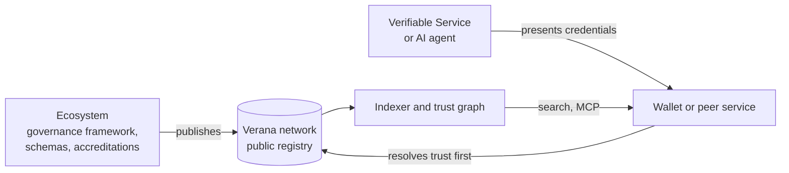

# What is Verana

Verana is open, public trust infrastructure. It answers three questions that the internet never had a shared way to answer: who is allowed to issue and verify a given credential, who is really behind a service or an AI agent, and how do you find services you can trust.

It is not a wallet, not an identity provider, and not a certification authority. It is the public layer those things plug into.

## The problem it solves

Digital services identify themselves with a domain and a TLS certificate. That proves you reached the right server, not who operates it, what it is accredited to do, or whether a credential it issues means anything. Every ecosystem that issues credentials, from a national identity scheme to an industry certification body, publishes its list of recognised issuers in its own format, behind its own API, if at all. Wallets and relying parties cannot verify an unfamiliar issuer without bespoke integration. AI agents inherit the same gap: an agent talking to another agent has no standard way to check who operates it and what it may do.

## What Verana adds

Verana puts three things on a public, decentralised registry, and gives every participant the same tools to read them.

**Ecosystems.** An organisation that governs a domain of trust, a chamber of commerce, a certification body, a government registry, a sector association, creates an ecosystem on the registry. It publishes its governance framework, defines the credential schemas it governs, and accredits who may issue and who may verify each of them. Those accreditations form a public tree: the ecosystem at the root, optional grantors below it, issuers and verifiers at the leaves. The ecosystem can attach a business model to the tree: validation fees to join, fees per issuance or verification shared along the tree, and a trust deposit every participant stakes and can lose.

**Identity.** A service or an AI agent becomes a Verifiable Service: it is identified by a DID, its DID Document presents credentials that say what the service is and who operates it, and it declares the endpoints through which it can be reached. Those identity credentials come from the ECS ecosystem, the first ecosystem on every network, whose accredited issuers verify legal entities and people. Before anyone connects to a Verifiable Service, their wallet or their own service resolves trust: it verifies the credentials, finds the accreditations on the registry, follows the chain to the ecosystem that governs each one, and shows a Proof-of-Trust. Offers and requests are accepted only from accredited issuers and verifiers.

**Discovery.** Because accreditations and credentials are public, an indexer can crawl the registry and the DID Documents it points to, evaluate the trust of every DID, and build a trust graph. Search then means asking the graph: which shops in this city hold a verified business credential, which ecosystems issue a given certification, where is the support agent of this company. AI agents ask the same questions through the Verana MCP server.

## How it is run

The registry is a public blockchain, the Verana network, built with the Cosmos SDK. Anyone can run a node, an indexer, a graph or the frontend; the public instances are a convenience, not a dependency. Transaction fees are paid in the network's coin; business fees between participants can be priced in that coin, in a value-stable trust unit, or in fiat settled off chain.

Governance of the network, and of the ECS ecosystem that anchors identity, is the responsibility of the Verana Council, a body of founding organisations. Specifications and software are open source and stewarded by the Verana Foundation.

## What is live

| | State |
|---|---|
| Specifications | Verifiable Trust v4 and Verifiable Public Registry v4 are stable; component specifications are at draft stage and tracked in verana-spec |
| Testnet | v4 from 13 October 2026, with public indexer, frontend, faucet and playground |
| Devnet | v4, used for integration work |
| Mainnet | planned for the first quarter of 2027 |

## Where next

- [How the pieces fit](./how-the-pieces-fit.md): the runtime picture.
- [What you can do](./what-you-can-do.md): the jobs this documentation helps with, and where each starts.
- Try it live: the [playground](https://playground.testnet.verana.network) walks a company through becoming verifiable and lets you try it with a real wallet.
- Specification: [Verifiable Trust v4](https://verana-labs.github.io/verifiable-trust-spec/versions/v4/), introduction.
